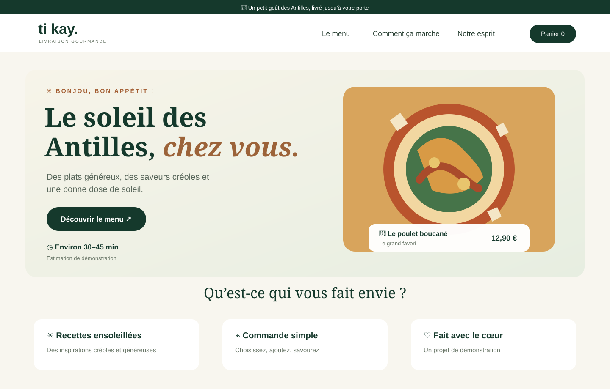
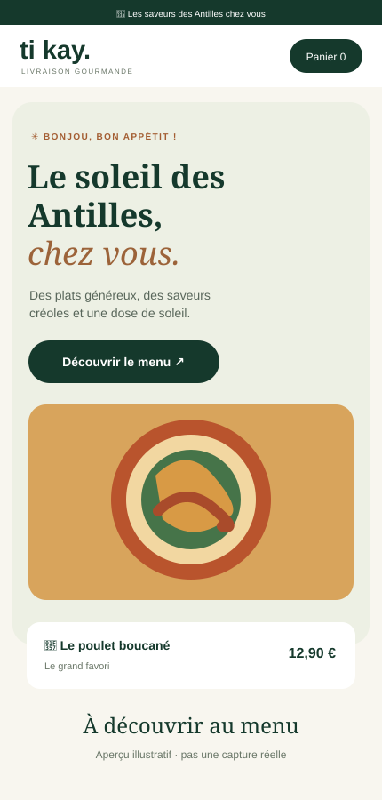

# Ti Kay Livraison 🌴 — Commande de repas

A responsive French-language food delivery website concept inspired by Caribbean flavours. Built as a front-end portfolio project.

## Visual previews

### Desktop preview

### Mobile preview

> These are illustrative SVG previews of the design, not screenshots captured from a running browser. They help visitors quickly understand the intended desktop and mobile layouts.

## Features
- Responsive layout for desktop, tablet and mobile
- Search and category filters for the menu
- Product cards with example prices and descriptions
- Interactive shopping cart with quantity controls and subtotal
- Accessible labels, keyboard Escape support, and reduced-motion support
- Demo checkout notice: no real order, delivery, account, or payment processing

## Technologies
- HTML5
- CSS3
- Vanilla JavaScript
- SVG for visual previews

## Run locally
Open `index.html` in a modern browser. No build step is required.

## Important
This is a demonstration/portfolio project. Menu items, ratings, prices, images, and delivery-time text are illustrative, not a real restaurant offer. Images are loaded from Unsplash. No customer data is collected and no orders or payments are submitted.

Created by Daniel Joseph.
